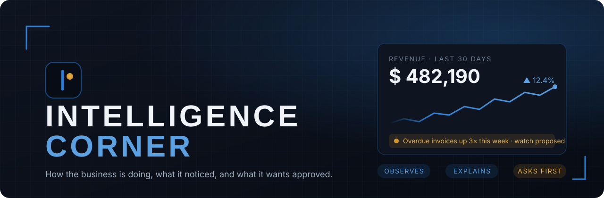
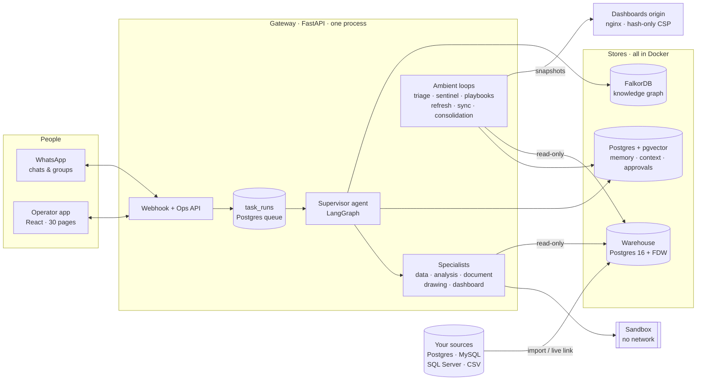
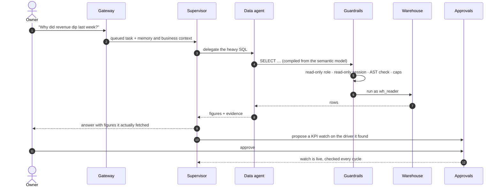

<div align="center">



<h3>An AI analyst that lives in your business chat, knows your data,<br>watches what matters, and asks before it acts.</h3>

<p>


<a href="LICENSE"></a>
</p>

<p>
<a href="#-what-it-does">What it does</a> ·
<a href="#-how-it-works">How it works</a> ·
<a href="#-agents-propose-humans-approve">Approvals</a> ·
<a href="#-safety-lives-in-code-not-in-prompts">Safety</a> ·
<a href="#-quick-start">Quick start</a> ·
<a href="#-repository-layout">Layout</a>
</p>

</div>

---

Most "chat with your data" tools wait to be asked a question. **Intelligence Corner doesn't wait.**

You connect it to your business databases and your WhatsApp. It learns what your tables mean and asks you to confirm. It builds a governed model of your metrics, watches your KPIs, explores the data overnight, and turns what it finds into cases, dashboards and forecasts. It sits in your team's groups and stays quiet until someone talks to it.

Everything with a side effect lands on your **Approvals** page first: a new KPI watch, a dashboard publish, a schema note, a new data source. Nothing reaches your business database except read-only SQL.

The whole system runs from one `docker compose` on a laptop, a VM or any cloud.

<br>

## ✦ What it does

<table>
<tr>
<td width="50%" valign="top">

### 💬 Answers in chat, grounded in data
Ask on WhatsApp or in the app: *"why did collections slow down last week?"* A supervisor agent sends the work to specialist agents. They query your data read-only, run the statistics in a sandbox, and reply with figures they actually fetched. If a reply quotes numbers that no tool produced this turn, the agent is asked again, and if it still can't back them, the reply goes out marked *"Not checked against data"*.

</td>
<td width="50%" valign="top">

### 👁️ Watches the business for you
KPI watches are compiled from governed measures and checked by a watchdog loop with no LLM in the way. When data is stale, the check is skipped instead of raising a false alarm. A nightly exploration playbook looks for anomalies, drivers and trends, and records each one as an insight with its evidence.

</td>
</tr>
<tr>
<td valign="top">

### 📊 Builds dashboards that can't be hijacked
Agents describe a dashboard as a **declarative chart spec** with 17 tile types, sections, a date control and page filters. A fixed, pinned renderer draws it. No agent-written script, style or markup ever runs. Every version is immutable, publishing needs approval, and rollback is one click.

</td>
<td valign="top">

### 🧠 Remembers, and keeps the memory clean
Working memory in pgvector and a temporal knowledge graph (Graphiti on FalkorDB) remember facts, people, preferences and past cases. Near-duplicate learnings merge nightly. Each run gets one context block that fits its token budget, so memory cost stays flat as the install gets older.

</td>
</tr>
<tr>
<td valign="top">

### 🔌 Connects your data and gives it meaning
Postgres, MySQL, SQL Server and CSV sources are **imported** (incremental, via dlt) or linked **live** (via foreign data wrappers) into a private warehouse. Schema discovery drafts what each table means, and a **semantic model** of tables, relationships and measures compiles every metric to one safe SQL query. A metric that isn't modelled gets the answer *NOT MODELED*, never a guess.

</td>
<td valign="top">

### 🗂️ Handles the paperwork too
Invoices, spreadsheets and documents become structured fields behind a human gate. CAD drawings can be split into layers, rebuilt and compared. Forecasts are approved definitions that refresh themselves. Recurring patterns in closed cases become *draft* playbooks for a person to switch on.

</td>
</tr>
</table>

<br>

## ✦ How it works

One Python process and a set of long-lived loops. No Redis, no Celery, no message broker: the job queue is a Postgres table claimed with `FOR UPDATE SKIP LOCKED`.



### One question, end to end



<br>

## ✦ Agents propose. Humans approve.

Autonomy is **earned per capability and enforced inside the tool functions**, so no prompt can talk its way around it. Each playbook carries a tier, and every tool checks it against a single default-deny table:

| Capability | `notify` | `autonomous_message` | `draft` |
|---|:---:|:---:|:---:|
| Message the operator | ✅ | ✅ | ✅ |
| Read the case overview | ✅ | ✅ | ✅ |
| Escalate to whoever raised the case | ✅ | ✅ | — |
| Send a reminder to a registered person | — | ✅ | — |
| Post to the case's group | — | ✅ | — |
| Queue a draft action for approval | — | ✅ | ✅ |

A denied call gets back `TIER REFUSED: …`. WhatsApp messages are the only side effect that can ever be autonomous. Everything else becomes an `actions` row that a person approves, and each approval executes exactly once, even if two people click at the same moment. Agent configuration can **narrow** an agent's tools but never grant new ones: a hard per-agent superset is the ceiling.

<br>

## ✦ Safety lives in code, not in prompts

<table>
<tr><td width="34%"><b>🔒 Four locks on business data</b></td><td>
A dedicated <b>read-only role</b>, a session opened with <code>default_transaction_read_only=on</code>, <b>sqlglot AST validation</b> (one SELECT only; write nodes inside CTEs, side-effecting functions like <code>pg_read_file</code> / <code>dblink</code> and credential catalogs are rejected), and a statement timeout plus a <b>server-side</b> row cap. Any one lock on its own blocks a write.
</td></tr>
<tr><td><b>📦 Sandboxed code</b></td><td>
Python analysis runs in a throwaway container per run: <code>--network none</code>, 384 MB, half a CPU, a 256-process ceiling against fork bombs, and a 120 s timeout.
</td></tr>
<tr><td><b>🧱 Dashboards on their own origin</b></td><td>
Spec-only versions, a pinned renderer, a hash-only CSP with Trusted Types, and token-gated snapshots. People viewing a dashboard <b>never touch the business database</b>; only the refresh loop writes snapshots.
</td></tr>
<tr><td><b>🗝️ Secrets never pass through chat</b></td><td>
Source credentials go into an AES-256-GCM vault through a form. Agents only ever see a <code>cred:&lt;name&gt;</code> handle. Settings secrets are encrypted at rest with a key that is kept out of backups.
</td></tr>
<tr><td><b>🧭 Prompt-injection hygiene</b></td><td>
Invoices, polled rows, group messages and web pages are all untrusted input. Filenames the model chooses resolve only inside the run's scratch folder. Web research runs on Anthropic's servers, so the gateway never opens an outbound socket for it.
</td></tr>
<tr><td><b>👥 No guessing who's who</b></td><td>
No fuzzy matching anywhere: unknown senders stay unresolved until a person decides. A group stays silent until someone switches it on, and outbound messages go only to registered people.
</td></tr>
<tr><td><b>💸 Token budgets</b></td><td>
Playbook runs, chat runs, data-agent delegations and context-pack work each have hard budgets. Conversation prompts are cached. Every model call lands in a usage ledger with its cost, shown per install on the Usage page.
</td></tr>
</table>

<br>

## ✦ The operator app

A React + TypeScript app for the business owner, served from its own container:

> **Today** · **Overview** · **Ask** · **Approvals** · **Cases** · **Insights** · **KPIs & Watches** · **Forecasts** · **Dashboards** · **Model** · **Data sources** · **Schema** · **Rules** · **Memory graph** · **People** · **Chats** · **Playbooks** · **Agents** · **Skills** · **Runs** · **Usage** · **Health** · **Setup**

Setup is where everything gets wired: LLM keys, data sources, the WhatsApp connector, timezone. Changes apply **live**, so nobody has to SSH in to edit `.env`. The app boots with an empty `.env` and shows exactly what is still unconfigured.

<br>

## ✦ Skills, not hard-coded features

Behaviour is packaged as **skills** (a `SKILL.md` plus references) that agents load on demand with `use_skill`. The repo ships twelve analytics skills of its own:

`anomaly-detection` · `connect-data-source` · `context-pack-import` · `dashboard-authoring` · `data-modeling` · `driver-analysis` · `exploratory-data-analysis` · `forecasting` · `kpi-selection` · `schema-documentation` · `statistical-tests` · `trend-and-seasonality`

They sit alongside a curated library of **165 skills** in `skills_library/`, each with its source and license recorded in `skills_library/manifest.json`.

<br>

## ✦ Quick start

### Everything in Docker, one machine

```bash
git clone https://github.com/naman113/intelligencecore.git
cd intelligencecore

./setup.sh          # writes .env with a fresh OPS_KEY + WEBHOOK_SECRET, builds the sandbox image
docker compose -f docker-compose.yml -f docker-compose.local.yml up -d --build
```

On Windows with Docker Desktop:

```powershell
.\deploy\local.ps1 up       # build + start everything
.\deploy\local.ps1 qr       # pair WhatsApp (once)
.\deploy\local.ps1 status   # containers, health, WhatsApp link
```

| What | Where |
|---|---|
| Operator app | http://localhost:8090 (sign in with `OPS_KEY`) |
| Gateway + Ops API | http://localhost:8080 |
| Dashboards origin | http://localhost:8091 |

Then open **Setup**, add an Anthropic (or OpenAI) key and connect a database. Try it without WhatsApp:

```bash
curl -X POST localhost:8080/api/test-message \
  -H "content-type: application/json" -H "x-ops-key: $OPS_KEY" \
  -d '{"phone":"test-local","message":"what tables do we have?"}'
```

### A dedicated Linux VM, with TLS

```bash
sudo ./install.sh --domain example.com     # app.example.com + dash.example.com, auto-TLS via Caddy
# or: sudo ./install.sh --ip-only
```

The installer sets up Docker, uv, Caddy and a systemd unit, and prints the admin key **once**. Day-2 operations go through `agentctl`:

```bash
agentctl status | logs | restart | update | rollback <ref> | selftest | backup | restore
agentctl readonly-role --print-sql      # the exact read-only role to create on your database
```

<br>

## ✦ Repository layout

```
backend/
  app/
    main.py              gateway: webhook, ops API, lifespan loops
    worker.py            task queue processor (Postgres SKIP LOCKED)
    agents/graph.py      LangGraph supervisor + specialist agents
    guardrails.py        the four locks on business data
    modelcompiler.py     semantic model → one safe SQL query (pure: no DB, clock or LLM)
    dashboardspec.py     chart-spec v1/v2 schema and compiler
    sentinel.py          KPI watchdog          triage.py      ambient group triage
    playbooks.py         goal-driven playbooks  expectations.py  scheduler
    memory*.py           pgvector learnings + Graphiti knowledge graph
    contextassembler.py  every memory source → one budgeted block
    sourcevault.py       AES-256-GCM credential vault
    warehouse.py whlink.py   warehouse roles, FDW links, catalog snapshots
    docintel.py layerlens.py  documents → fields; CAD layer deconstruction
    schema.sql           the whole data model, idempotent
  tests/                 316 test modules
frontend/                operator app (React 18, TypeScript, Vite)
dashboards/              pinned renderer + vendored chart library, served by nginx
wa-connector/            WhatsApp connector (Node, Baileys)
sandbox/                 code-execution image (pandas, numpy, scipy, statsmodels, scikit-learn)
infra/                   warehouse image, ic-sync loader (dlt), db init
deploy/                  agentctl, Caddy template, Windows launcher, read-only role SQL
skills_library/          165 skills, 12 of them Intelligence Corner's own
docs/                    dashboard contract + JSON schemas the code and tests pin to
```

<br>

## ✦ Built with

| Layer | Stack |
|---|---|
| Agents | LangGraph ReAct supervisor with specialists wired as tools · Claude Opus / Sonnet / Haiku 5.5, OpenAI fallback, model chosen per agent |
| API | FastAPI · asyncpg · Pydantic |
| Data safety | sqlglot AST validation · read-only roles · Postgres FDW (`postgres_fdw`, `mysql_fdw`, `tds_fdw`) |
| Memory | Postgres + pgvector (HNSW) · Graphiti temporal knowledge graph on FalkorDB |
| Ingestion | dlt · pyarrow, in short-lived `ic-sync` containers |
| Front end | React 18 · TypeScript · Vite · Chart.js |
| Ops | Docker Compose · Caddy · systemd · Langfuse · built-in usage ledger |

<br>

## ✦ Engineered to be trusted

- **~56k lines** of Python in the gateway, **~20k lines** of TypeScript in the app
- **7,600+ automated tests**: about 6,900 backend tests and 695 front-end tests, plus suites for the connector and the sync loader
- **Hostile-input checks** that push attacker text through every free-text field of a dashboard and prove none of it runs
- **Fail-soft everywhere:** the HTTP listener comes up before anything else, and `/health` says *"database unreachable"* in plain words instead of crash-looping
- **Swappable seams:** every external dependency has exactly one module allowed to touch it

<br>

<div align="center">
<sub>Built by <a href="https://github.com/naman113">Naman Sherasia</a> · Intelligence Corner · <a href="LICENSE">MIT License</a></sub>
</div>
